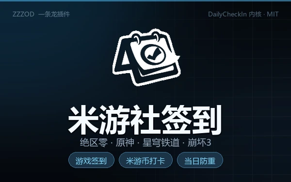

# 米游社签到（mys_checkin）

一条龙运行时顺便完成米游社每日签到，全程不操作游戏（纯网络请求，子进程托管）。



## 功能

- **游戏签到领福利**：绝区零 / 原神 / 崩坏:星穹铁道 / 崩坏3，自动识别全部已绑定角色
- **米游币打卡**：多分区打卡，自动统计收益（可在工具配置关闭）
- **可选库街区**：鸣潮 / 战双帕弥什每日补给（默认关闭，登录时选填）
- **当日防重签**：state.json 按天记录，同一天重复运行直接跳过
- **免维护续期**：cookie_token 过期自动用 stoken 续期

## 内核

[vendored checkin.py](mys_checkin/vendor/checkin.py) 来自 [Maratrain/DailyCheckIn](https://github.com/Maratrain/DailyCheckIn)（MIT License），单文件、仅依赖 `requests`（随基座环境自带）。版本基线见 `mys_checkin/vendor/README.md`，上游更新后替换该文件即可。

## 首次使用（只需一次登录）

在本插件目录执行命令（或使用上游 GUI）：

```bash
python mys_checkin/vendor/checkin.py login
```

登录状态存储在 `mys_checkin/vendor/config.json`（含 stoken 等凭据，**已被 .gitignore 排除，不会提交**）。

### 两种登录方式，权限不一样（重要）

| 方式 | 游戏签到 | 米游币打卡 | 说明 |
| --- | --- | --- | --- |
| **短信验证码**（推荐） | ✅ | ✅ | 拿到完整权限 stoken，功能全开 |
| App 扫码 | ✅ | ❌ | 2026-09 起米哈游限制了扫码 stoken 权限，米游币接口会直接报无权限 |

> 只想要游戏签到的话可以选扫码；想连米游币一起签，必须走短信登录。
>
> **两者不要混着配**：如果你用扫码登录，请把 `config.json` 里的 `mihoyo.bbs_checkin` 设为 `false`。否则米游币打卡必然失败，脚本退出码会变成 1，插件会把整轮判为失败（此时游戏签到其实已经成功）。

## 配置

| 配置项 | 默认 | 说明 |
| --- | --- | --- |
| probe_mode | 关 | 打开后只运行 `checkin.py test` 查询登录/签到状态，不真实签到。仅用于排查，长期开着等于没签 |
| timeout_seconds | 300 | 子进程超时（米游币多分区打卡较慢，可调大） |

签到游戏列表 / 米游币开关 / 库街区开关在 `mys_checkin/vendor/config.json` 中调整：`mihoyo.game_sign`、`mihoyo.bbs_checkin`、`kuro.enabled`、`weibo.enabled`。

## 运行结果

每次运行写入 `.debug/mys_checkin/last_run.json`（状态、退出码、state 快照），签到明细见运行日志中 `[checkin]` 前缀行。

## 风险说明

- 凭据（stoken/cookie）保存在本机 `mys_checkin/vendor/config.json`，请勿外传
- 签到接口由上游工具维护，米哈游风控变化时需跟进上游更新
- 本插件不读取、不上传任何游戏内数据

## 更新记录

- **0.1.1**：新增封面与透明 logo；README 补充「扫码 vs 短信」权限差异与 `bbs_checkin` 联动说明；`probe_mode` 默认改为关闭（原默认打开会导致装完只查不签、静默无产出）
- **0.1.0**：首版，vendored DailyCheckIn 内核，probe 默认开，state 防重签

## 许可

- 本插件：见 [LICENSE](LICENSE)（GPL-3.0）
- vendored checkin.py：MIT License（见 mys_checkin/vendor/LICENSE）
