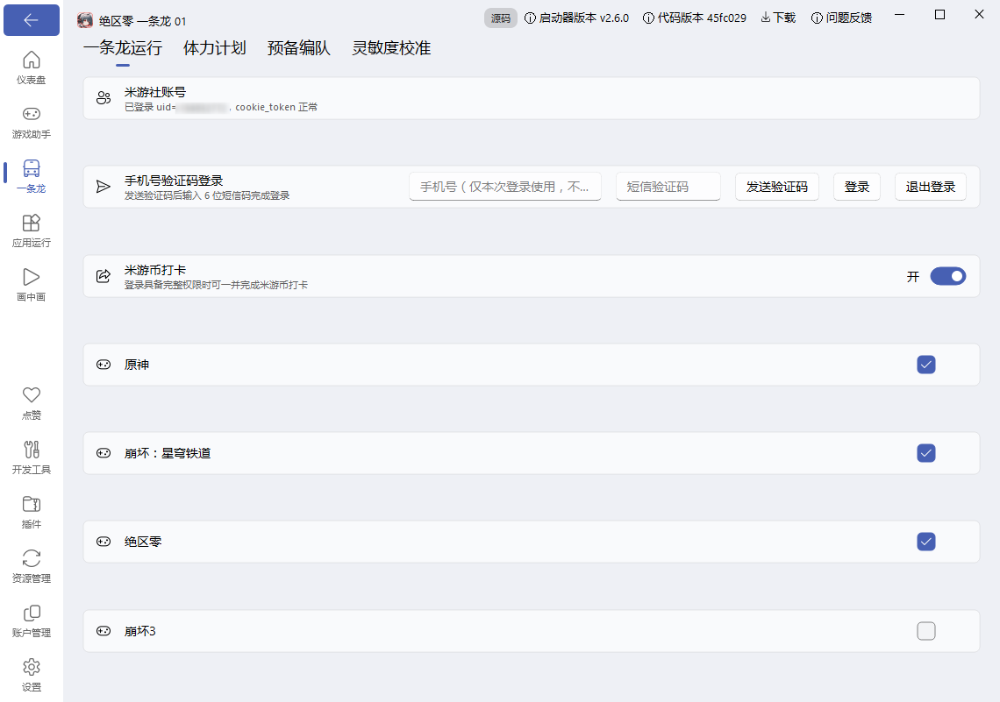
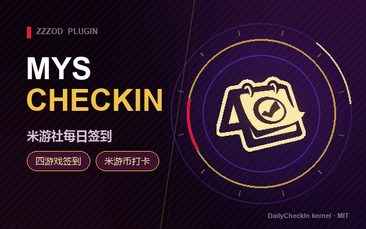

# 米游社签到（mys_checkin）

一条龙运行时顺便完成米游社每日签到，全程不操作游戏（纯网络请求，子进程托管）。

## 功能状态对账

| 功能 | 状态 | 说明 |
|---|---|---|
| 游戏签到 | ✅ 实机验证 | 2026-11-06 实机通过（含日志编码修复） |
| 米游币打卡 / 库街区 | ✅ 已实现 | 随签到链路执行 |
| GUI 配置页 | ✅ 实机验证 | 2026-11-08 实机通过：设置页内手机号验证码登录 + 签到选项 |





## 功能

- **游戏签到领福利**：绝区零 / 原神 / 崩坏:星穹铁道 / 崩坏3，自动识别全部已绑定角色
- **米游币打卡**：多分区打卡，自动统计收益（可在工具配置关闭）
- **可选库街区**：鸣潮 / 战双帕弥什每日补给（默认关闭，需单独登录后才可开启）
- **当日防重签**：state.json 按天记录，同一天重复运行直接跳过
- **免维护续期**：cookie_token 过期自动用 stoken 续期

## 内核

[vendored checkin.py](mys_checkin/vendor/checkin.py) 来自 [Maratrain/DailyCheckIn](https://github.com/Maratrain/DailyCheckIn)（MIT License），单文件、仅依赖 `requests`（随基座环境自带）。版本基线见 `mys_checkin/vendor/README.md`，上游更新后替换该文件即可。

## 首次使用（只需一次登录）

两种登录入口，**只用手机号 + 短信验证码**：

- **GUI 设置页（推荐）**：一条龙列表 → 米游社签到卡片右侧「设置」→ 输入手机号 → 发送验证码 → 输入 6 位短信码登录。登录后可在同一页面勾选签到游戏、开关米游币打卡、退出登录。
- **CLI 交互**：

```bash
python mys_checkin/mys_login.py           # 输入手机号 -> 收码 -> 输入 6 位验证码
python mys_checkin/mys_login.py status    # 核对登录态与权限
```

登录状态存储在 `mys_checkin/vendor/config.json`（含 stoken 等凭据，**已被 .gitignore 排除，不会提交**）。

### 为什么只做手机号登录

2026-09 起米哈游限制了 App 扫码换来的 stoken 权限：游戏签到能用，**米游币打卡会直接报无权限**。扫码还要求你在另一块屏幕上盯着二维码刷新，无头 / 远程 / 计划任务场景下体验很差。所以本插件不提供扫码路径，只保留权限完整、可脚本化的手机号登录。

### 隐私

- 手机号只在本次进程内存里使用：**不进命令行参数**（避免 shell 历史与进程列表泄露）、**不写入 config.json**
- 终端回显只保留前 3 位，其余位一律不打印
- `config.json` 只存 stoken / uid / mid / device_id 等凭据，且已被 `.gitignore` 排除
- 发送验证码若被人机验证拦下（retcode `-3101`），去 [user.mihoyo.com](https://user.mihoyo.com/#/login) 用同一手机号过滑块并点「获取验证码」（**不要点登录**），把收到的 6 位码输回插件即可，登录照样能完成

> 只想要游戏签到、不想开米游币：把 `config.json` 的 `mihoyo.bbs_checkin` 设为 `false`。短信登录具备完整权限，开着也不会失败，纯粹是省掉几次请求。

> 需要库街区（鸣潮 / 战双）或微博超话：这两个跟米游社是独立账号，插件自带的 `mys_login.py` 只管米游社。要用就走上游完整交互入口 `python mys_checkin/vendor/checkin.py login`（里面会问库街区和微博），登录后再把 `config.json` 里 `kuro.enabled` / `weibo.enabled` 设为 `true`。

## 配置

| 配置项 | 默认 | 说明 |
| --- | --- | --- |
| probe_mode | 关 | 打开后只运行 `checkin.py test` 查询登录/签到状态，不真实签到。仅用于排查，长期开着等于没签 |
| timeout_seconds | 300 | 子进程超时（米游币多分区打卡较慢，可调大） |

米游币开关、签到游戏列表可在 **GUI 设置页**直接调整；库街区 / 微博等其余开关在 `mys_checkin/vendor/config.json` 中调整（`kuro.enabled`、`weibo.enabled`）。

## 运行结果

每次运行写入 `.debug/mys_checkin/last_run.json`（状态、退出码、state 快照），签到明细见运行日志中 `[checkin]` 前缀行。

## 风险说明

- 凭据（stoken/cookie）保存在本机 `mys_checkin/vendor/config.json`，请勿外传
- 签到接口由上游工具维护，米哈游风控变化时需跟进上游更新
- 本插件不读取、不上传任何游戏内数据

## 更新记录

- **0.2.0**：新增 GUI 设置页（`mys_checkin_app_setting.py` + `mys_checkin_setting_interface.py`）：一条龙列表内直接手机号验证码登录/退出登录、勾选签到游戏、开关米游币打卡；号码不落盘不进配置，登录与配置复用同一 vendored 内核。2026-11-08 实机验证通过（入口：一条龙运行 → 米游社签到卡片右侧齿轮）

- **0.1.4**：登录模块与文档中的号码回显统一为省略号形式

- **0.1.3**：封面改为红紫金配色并统一到 `assets/ui/cover.png`（与其余插件同版式同路径：左侧标题栏 + 右侧环形主体），logo 一并移入 `assets/ui/`

- **0.1.2**：新增 `mys_login.py` 登录入口，只做手机号验证码登录（号码不落盘、不进命令行参数、回显省略），README 与摘要同步收敛为「仅手机号登录」；移除打包内冗余的 `assets/cover.png`
- **0.1.1**：新增封面与透明 logo；README 补充「扫码 vs 短信」权限差异与 `bbs_checkin` 联动说明；`probe_mode` 默认改为关闭（原默认打开会导致装完只查不签、静默无产出）
- **0.1.0**：首版，vendored DailyCheckIn 内核，probe 默认开，state 防重签

## 许可

- 本插件：见 [LICENSE](LICENSE)（GPL-3.0）
- vendored checkin.py：MIT License（见 mys_checkin/vendor/LICENSE）
